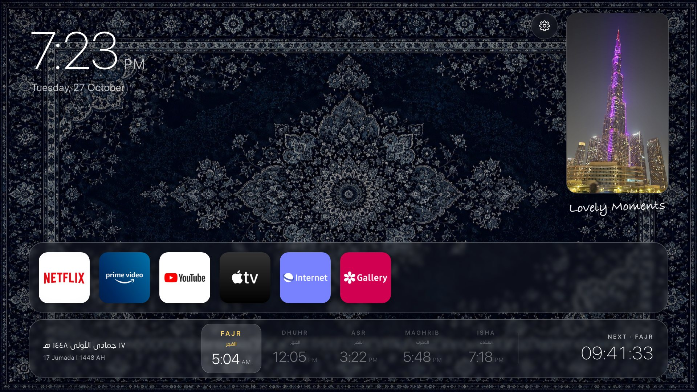
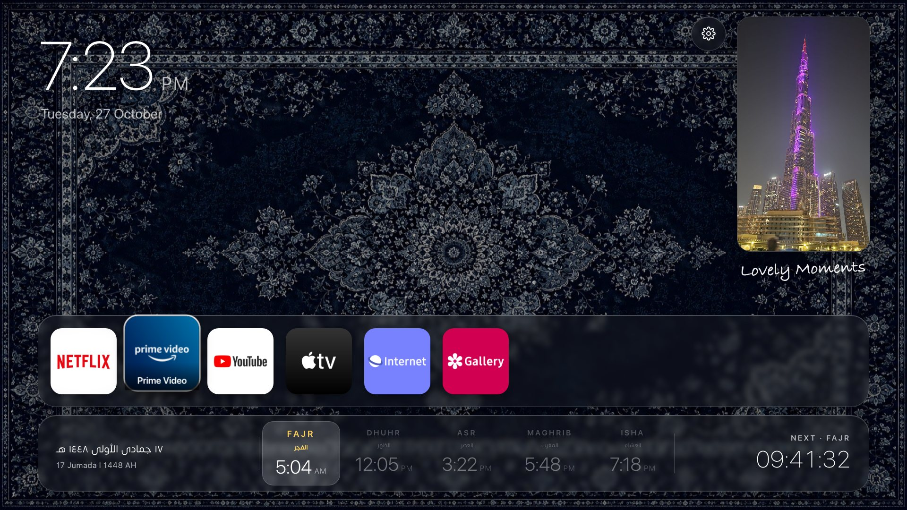
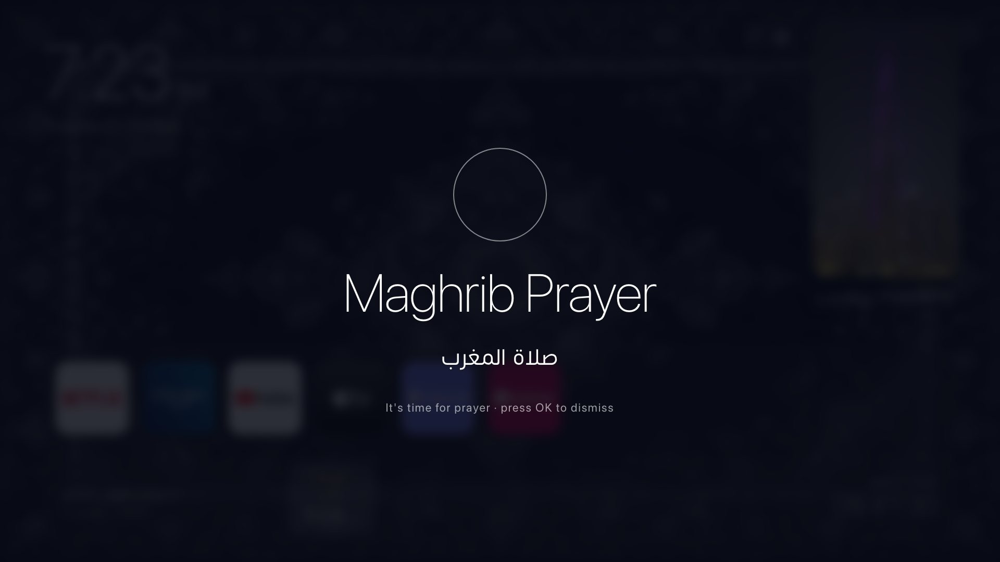
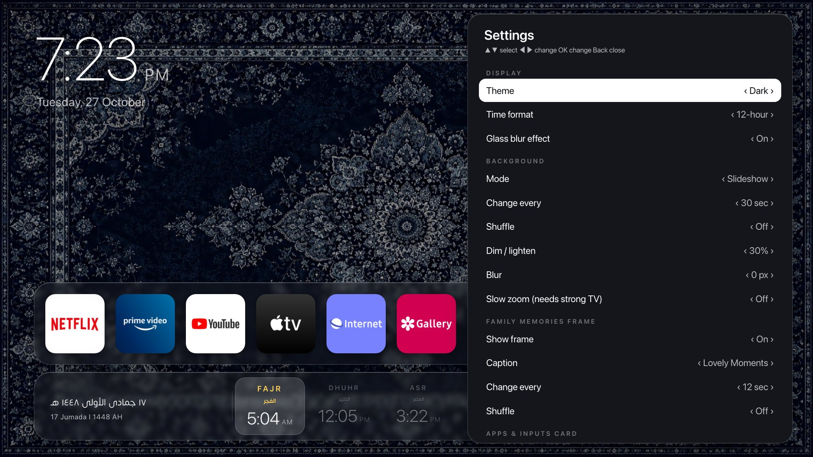
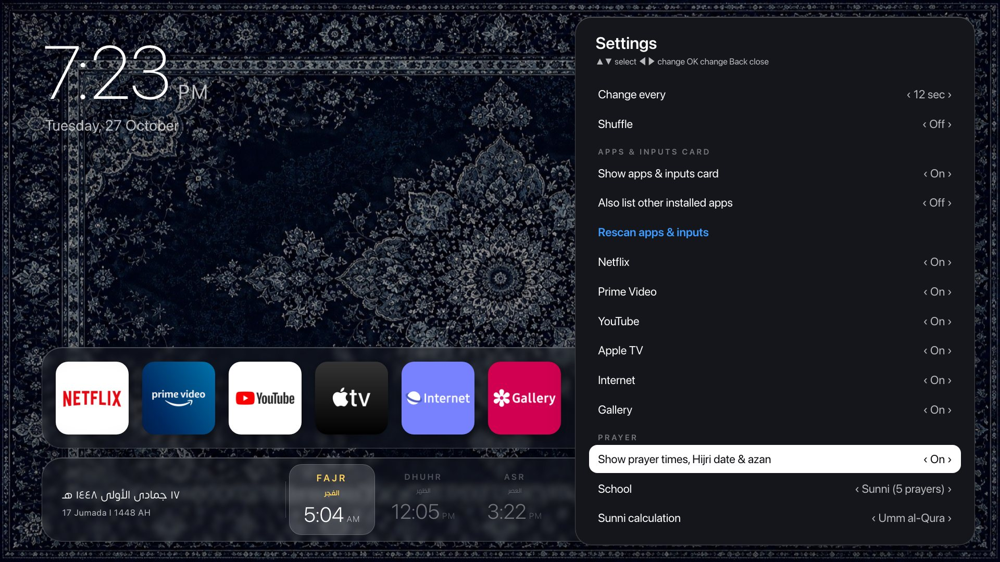
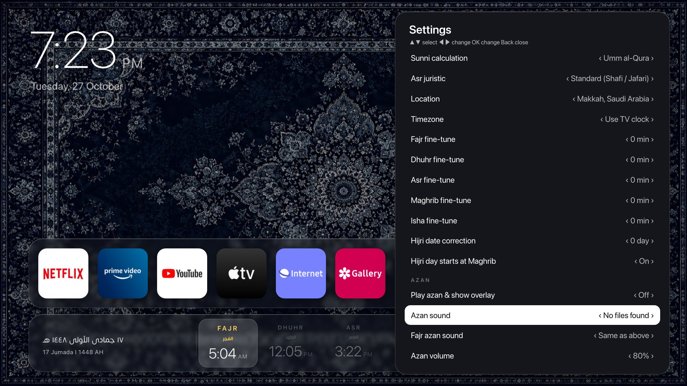
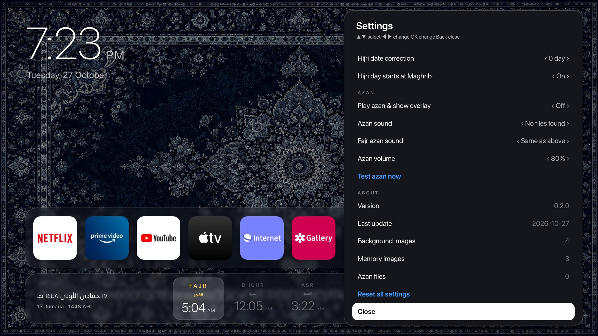
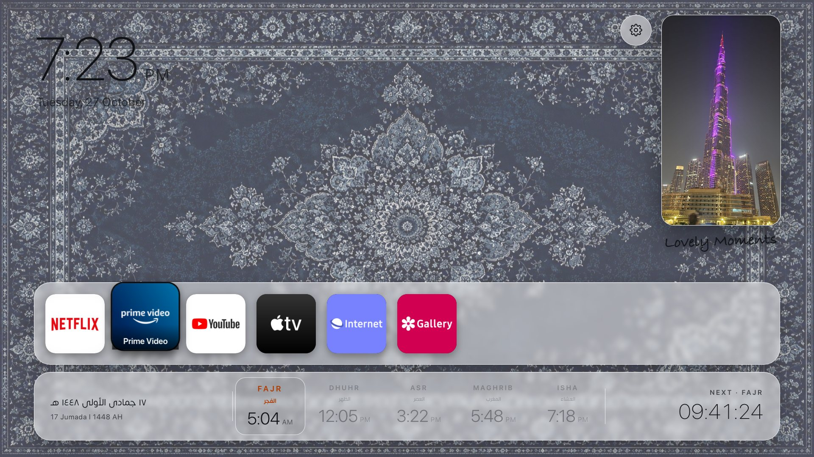
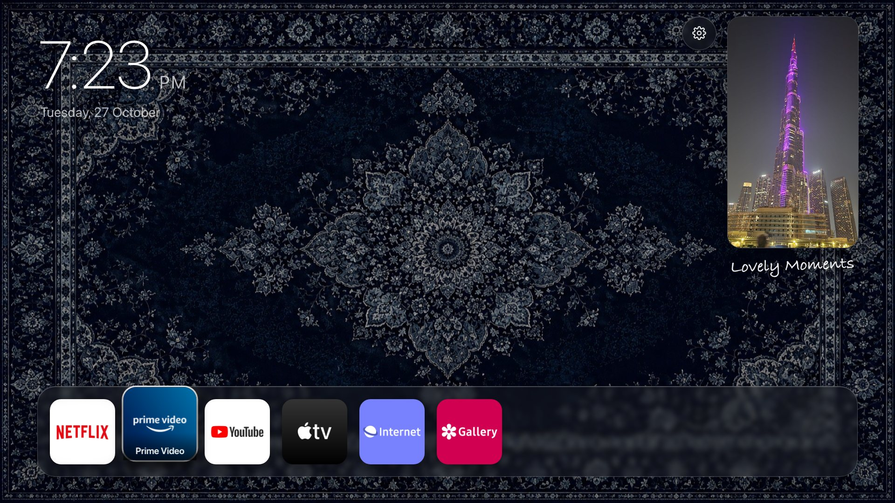
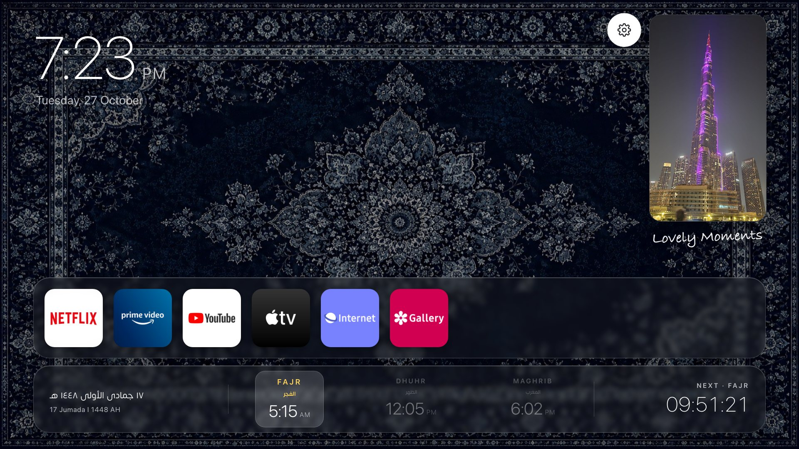

# Home Frame for Samsung TVs

**An ambient home screen for Samsung Tizen TVs: big clock, photo slideshow, a vertical family-memories frame, a launcher for your apps and inputs, and optional Islamic prayer times with azan.**
Plain HTML, CSS and JavaScript. No account, no server, no internet needed once installed.



> **The easy way:** give this repository's link to an AI assistant (Claude, ChatGPT, Gemini...) and say
> **"Set this up on my Samsung TV."** It reads [AGENTS.md](AGENTS.md) and walks you through every step: it checks your TV model first,
> helps you turn on Developer Mode, installs the tools, signs and installs the app, and at the end asks you to attach your own photos.

## What it does

- **Clock and date** in the top corner, 12 or 24 hour.
- **Background slideshow** from your photos (or one fixed photo, or a solid colour), with dim and blur controls.
- **Family memories frame** on the right: a 9:16 vertical slideshow with a handwritten caption ("Lovely Moments" by default).
- **Apps and inputs card:** your TV's home-row apps with their real icons, plus HDMI and other inputs. Move with the remote, press OK to open. The selected tile floats up.
- **Prayer card (optional):** Fajr, Dhuhr and Maghrib (Shia Ja'fari) or all five prayers (Sunni), a countdown to the next prayer, and the Hijri date. Calculated on the TV, so it works offline.
- **Azan:** at prayer time the screen blurs, shows the prayer name, and plays your azan `.mp3`. Press OK to dismiss.
- **Settings screen** with the remote: theme, time format, backgrounds, memories, apps, location, prayer fine-tuning, azan.
- **Smooth on real hardware.** Tuned on a 2021 Crystal UHD TV: the glass blur is kept light and the remote responds instantly.

## Screenshots

| | |
|---|---|
|  **Apps and inputs card.** Arrow keys move, OK opens the app, Up reaches the settings gear. |  **Prayer time.** Full-screen blur with the prayer name; the azan plays; OK dismisses it. |
|  **Settings: display, background, memories.** |  **Settings: choose your apps, school, prayer on/off.** |
|  **Settings: location, fine-tune minutes, azan sound and volume.** |  **Settings: version, media counts, reset.** |
|  **Light theme.** |  **Prayer hidden** for everyone who does not need it: the apps card drops into its place. |
|  **Shia mode:** Fajr, Dhuhr and Maghrib with a countdown. | |

The screenshots use the demo photos in this repository. Real TV app icons appear after you run `tools/fetch-home-apps.sh`.

## Quick start (manual)

You need: a Samsung smart TV from 2018 or later, a Mac or Linux computer (Windows: WSL), a free Samsung account, and the TV and computer on the same network.

1. **TV model check.** See the table below.
2. **Developer Mode** on the TV: Apps, enter `12345`, Developer Mode On, Host PC IP = your computer's IP, unplug the TV for 30 seconds.
3. **Install the Tizen CLI** and create a Samsung certificate: [docs/INSTALL-TIZEN-TOOLS.md](docs/INSTALL-TIZEN-TOOLS.md).
4. **Copy your TV's real apps and icons** (optional): `./tools/fetch-home-apps.sh <TV-IP>`
5. **Install:** `./tools/deploy.sh <TV-IP>`
6. **Your photos:** put them in `images/background/` (landscape, about 1920 px) and `images/memories/` (portrait 9:16) and an azan `.mp3` in `azan/`, delete the `demo-*` files, then run `./tools/deploy.sh <TV-IP>` again.

Problems? See [docs/TROUBLESHOOTING.md](docs/TROUBLESHOOTING.md).

## Which TVs work

| Year | Tizen | Status |
|---|---|---|
| 2021 (e.g. `UA55AU7000`) | 6.0 | **Tested** |
| 2018 to 2020, 2022 to 2023 | 4.0 to 7.0 | Expected to work, untested. On older TVs there is no glass blur (solid cards instead). |
| 2024 and later | 8.0+ | Untested. Samsung tightened developer rules. |
| 2017 and older | 3.0 and older | Unlikely |

Model codes: the letter after the size tells the year, for example `AU7000` is 2021, `TU7100` is 2020, `RU7100` is 2019, `NU7100` is 2018; on premium models the last letter is the year (`A` 2021, `B` 2022, `C` 2023, `D` 2024).
Please open an issue with your model and result so this table grows.

## Remote control

| Key | Action |
|---|---|
| Arrow keys | Focus the apps card; move between apps; Up goes to the settings gear |
| OK | Open the selected app, or open Settings when nothing is focused |
| Back | Close Settings, leave a full-screen input, or exit the app |
| OK / Back during the azan | Stop it and return to the home screen |

Settings: Up/Down select, Left/Right change, OK change or run.

## Customise

- **On the TV:** everything is in the Settings screen (gear icon, or OK on the idle screen).
- **Starting defaults** (prayer off, city, school, theme, caption): edit `data/settings.js`.
- **Photos:** `images/background/`, `images/memories/`. About 1920 px and 300 to 600 KB each keeps it smooth. Run `./tools/update-media.sh` or just redeploy.
- **Azan:** `.mp3` files in `azan/`, chosen in Settings. Pick a different file for Fajr if you like.
- **Fonts (optional):** drop `fonts/handwriting.ttf` for the caption. `css/style.css` also looks for SF Pro Display and Somar files in `fonts/` if you own them; otherwise the TV's default fonts are used.
- **Logo:** replace `icon.png` (117 x 117 px, PNG). Store listings use 512 x 423.
- **Cities:** add your own to `js/cities.js`, or choose "Custom coordinates" in Settings.

## Good to know

- **It is an app, not a launcher replacement.** Tizen does not let a third-party app draw over Smart Hub or other apps, so Home Frame works while it is the app on screen. Set the TV's **Autorun Last App** (General, Smart Features; wording varies) to start in Home Frame.
- **Prayer times are calculated, not looked up.** They use standard angle formulas: Ja'fari (Fajr 16 degrees, Maghrib 4 degrees, Isha 14) for Shia, and Umm al-Qura, MWL, Egyptian, Karachi or ISNA for Sunni. Always compare with your local timetable and use the fine-tune minutes. The Hijri date has a plus or minus day correction and can switch at Maghrib.
- **Opening apps and switching inputs** uses Samsung's Tizen APIs. App IDs differ between TVs; `tools/fetch-home-apps.sh` reads your own TV's list.
- **Developer Mode** is a normal Samsung feature for installing your own apps. Turn it off again any time. Installing an app you built does not change TV system settings.

## Project layout

```
index.html            page
config.xml            Tizen app manifest
css/style.css         look and feel
js/                   app logic: prayer.js (times), hijri.js, launcher.js (apps/inputs), settings.js, slideshow.js, azan.js, app.js
data/settings.js      your starting defaults
data/homeapps.js      apps card list (generated by tools/fetch-home-apps.sh)
images/, azan/, icons/, fonts/   your media (git-ignored except demo-* files)
tools/                deploy.sh, fetch-home-apps.sh, update-media.sh
docs/                 install and troubleshooting guides, screenshots
AGENTS.md             the AI setup guide
```

Try it on a computer: `./tools/update-media.sh && python3 -m http.server 8099`, then open `http://localhost:8099/index.html`. URL switches for screenshots are in `js/demo.js`.

## Credits and disclaimer

Demo photos are included so the app looks right on first launch; replace them with your own. App names and logos (Netflix, YouTube and others) belong to their owners and appear only because the TV shows them; this project is not affiliated with or endorsed by Samsung, Netflix, Google or any app vendor. Use at your own risk.

MIT licence. See [LICENSE](LICENSE).
